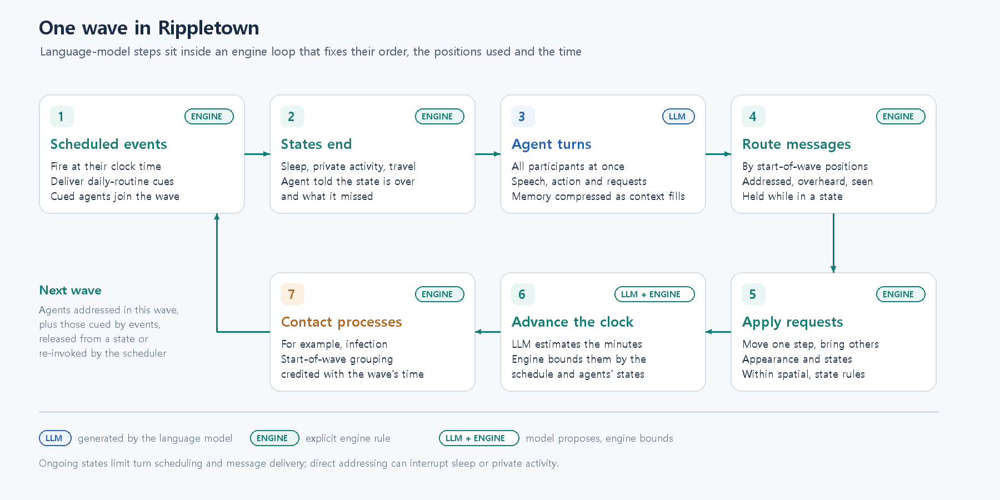

# Rippletown — Methods (draft)

Oct 13, 2026 · @Whansun

## Framework overview

Rippletown is a multi-agent simulation engine in which every individual is played by a large language model (LLM) agent, while an engine manages the world those agents inhabit. The engine maintains space, time, movement, bodily state and social ties; the LLM generates what an individual intends, says and attempts to do. The engine records agents' locations, co-presence and simulated durations, providing the basis for contact analysis. Where the model proposes a quantity, such as how long a scene lasted, the engine bounds it.

This division is communicated through an **engine contract**, which combines scenario-derived world rules with turn-specific instructions and context. Together they specify what an answer must look like, what each command means, which people and places the agent can address, the current time, and a description of how the agent's body feels. Because the contract is generated rather than stored with a scenario, improvements to the engine reach existing scenarios without editing them.

Each turn returns one structured answer: what the agent says and to whom, how it feels, what it physically does, and optional requests that change the world, such as moving, taking others along, changing appearance or entering a state like sleep. The engine resolves these requests under spatial and state constraints, and the agent's next context reflects the resulting world state rather than what it asked for.

The engine is independent of any particular story. A scenario supplies the people, their personas and relationships, the map, a shared background and scheduled events; the same engine can run a household, a workplace or a school without code changes. It runs behind a web interface or headless from the command line, and it records every utterance, movement, state change and time step, so that runs can be resumed, replayed and exported for analysis.

## Time, waves and daily routines

Simulated time advances in steps called **waves**. A wave is the set of agents that act together, and the agents in the next wave are mainly those addressed in the current one, alongside those called by scheduled events, ending states and the scheduler. The conversation itself, not a clock tick, therefore largely decides who acts next. Within a wave every participant receives what was delivered to it, produces one turn, and all turns are resolved together before the world is updated.

At the end of each wave the clock advances by the time that wave took:

```latex
T_{w+1} = T_w + \Delta t_w
```

The length of each wave, Δt_w, is inferred by the language model. A separate LLM call reads the wave's dialogue and actions, together with the current time, where the participants are and the next scheduled event, and estimates how many minutes the scene took, including off-screen actions such as setting a table or walking between rooms. The engine then adjusts the proposed value so that it respects the schedule and the agents' states:

1. **Scheduled events.** Time never jumps past an event that has not yet fired.
2. **Live conversation.** While people in the same place are talking to each other, time cannot leap far ahead.
3. **Waking hours.** During the day, long jumps are limited so that comings and goings are not skipped.
4. **State endings.** Time never jumps past the moment an agent's state, such as sleep, is due to end.

When nobody addresses anyone and nobody acts (moving, changing state or responding to a scheduled event), the engine skips ahead in growing steps instead of asking the model; pending events and state endings still limit these steps. When everyone is asleep or otherwise occupied, the clock moves toward the next event or state ending. A run continues until the configured simulated duration has elapsed.

**Daily routines** are supplied by the scenario as scheduled events. An event can be fixed to a clock time, repeated on chosen weekdays and limited to a range of simulated days; when it fires, it delivers a cue to the agents concerned, such as the time to leave for school, and gives them a turn. The schedule is therefore an input to the simulation, while what each agent does in response, whether it leaves on time, delays, or talks with others first, is generated by the agent.

Each agent sees the current weekday and time at every turn. When enough time has passed since its last turn, or a new day has begun, a time stamp is also written into its recent memory, so that it can tell whether the events it remembers happened on the same evening or on different days.

## Space: places, zones and exterior spaces

The world is a graph of named **places** grouped into **zones**, with designated **exterior spaces**. Places are the unit of co-presence: agents can converse only with others in the same place. Zones are the unit of awareness: an agent knows who else is present elsewhere in its zone, but must move there to speak to them. Exterior spaces stand for parts of the world that are not modelled; an agent there can neither see, hear nor be addressed by anyone.

Movement is always resolved by the engine. When an agent names a destination, the engine finds a route that crosses as few zone boundaries as possible and moves the agent one step per wave. A step within a zone is immediate. Crossing into another zone is physical travel: for its duration the agent is in neither place and meets no one except those travelling with it.

A route that passes through an intermediate zone forms a **journey**, and the agent is told the route before it sets off. If someone available is present at a stop on the way, the journey pauses so that the encounter can happen, and it resumes when the agent chooses the same destination again. The agent's prompt keeps the destination in view, so that a stop on the way does not erase the purpose of the trip.

## Agents

Each agent is defined by a persona, a starting place, an outward appearance and its own map of relationships. Each agent has its own memory and perceptual context, without direct access to other agents' private memories. Beyond the scenario's shared background, what an agent knows about the world comes from its own perception and interactions.

### Memory

At every turn an agent's context is assembled in a fixed order: its persona, the scenario's shared background, its long-term memory, its recent working memory, and finally a few lines that are regenerated each turn and never stored (the current time, its situation and its bodily condition).

**Working memory** holds the raw exchanges the agent has taken part in, each stamped with the simulated moment it happened. When working memory grows close to the agent's context budget, it is **compressed**. An LLM call reads the exchanges, grouped by simulated day and part of the day, together with the agent's existing memory, and returns three kinds of long-term memory:

- **Episodes**: dated events, recording what was wanted, what was done, how others reacted, what changed and what is still unresolved.
- **Facts**: things that stay true over time, such as traits, preferences, habits and standing ties, each with a confidence. Details that matter for one day only go to episodes instead.
- **Relationships**: the agent's current view of each person it knows, with earlier views kept as a history.

The compression prompt asks for absolute day labels in place of relative words such as "today", so that memories stay unambiguous across weeks.

New facts are matched against what the agent already knows rather than piled on top. The engine picks the existing facts most related to the new conversation and shows them, with identifiers, to the compressing model, which says whether each new fact is new, the same as an existing one, or a change to it. The engine checks those references and merges accordingly. A changed fact keeps its earlier versions and the conversations that supported them, so that every merge can be traced.

Long-term memory is re-rendered at every turn relative to the current time: recent episodes in detail, older ones as a few vague highlights, and facts in order of confidence. From time to time a **consolidation** pass reviews all facts and lowers confidence in details that were never supported again. Consolidation deletes nothing; low-confidence facts may be omitted from the displayed memory while remaining available for later retrieval.

### Perception

Agents perceive only what their position allows, judged from where everyone stood at the start of the wave.

**Hearing.** An utterance reaches the people it is addressed to if they are in the same place. Someone who has just walked out can still catch a parting answer; after that, the speaker has to follow. Ordinary conversation requires co-presence. Optionally, others in the same place overhear the exchange, tagged with who spoke to whom. Words addressed to no one stay private, but the physical action that goes with them is seen by the room.

**Sight.** Agents see arrivals, departures and the current appearance of those present, notice when someone they know looks different, and know their own appearance. Within a zone they know who is in other rooms without being able to address them. The contract also tells agents that only people in the same place can be seen, to discourage them from describing someone elsewhere as standing in front of them.

**Recognition.** Other agents are named only if the observer knows them (see Social structure). Unknown individuals appear by their appearance under a temporary label such as `stranger_1`, and names must be learned through interaction.

### Actions

Besides speaking, an agent can act on the world in four ways.

- **Movement.** The agent names a place, a person or its current location. A place starts a route or a journey. A person starts a pursuit: the engine steers the agent toward that person each wave until they meet. The current location means staying put.
- **Accompaniment.** Together with a destination, the agent can take along people who are in the same place, even someone who is asleep. Companions travel with the leader step for step and arrive together.
- **Appearance.** The agent rewrites its own outward appearance, for example by changing clothes, and others then see the change.
- **States.** The agent declares that it is entering a state, described below.

### States

An agent can declare that it is entering a state, such as sleep or a private activity. It chooses the kind of state, not its length; the engine draws the duration from the range set for that kind. The engine also places an agent in a travelling state while it crosses between zones. While in a state, an agent is not scheduled for turns, and messages that are not addressed to it are held. When the state ends, the agent is told so and given a summary of what it missed. Sleep or a private activity can still be interrupted: someone in the same place can wake the agent by speaking to it directly, and the agent then decides whether to stay in the state or leave it. A travelling agent remains out of reach until it arrives.

## Agent roles

Rippletown distinguishes two kinds of agents. **Protagonists** are the individuals under observation. They act autonomously: they decide when to speak, where to go, whom to take along and when to sleep, and the scheduler makes sure none of them is left without turns for long. **Role-bound agents** provide the services protagonists need in order to live in the world, such as a teacher at a school or a clerk at a shop. They are not the objects of study, and their behaviour is deliberately constrained:

| Property | Protagonists | Role-bound agents |
| --- | --- | --- |
| Turns | When addressed, at scheduled events, or when the scheduler brings them back in | Only when addressed or at scheduled events |
| Movement | Free, including taking others along | Fixed at their post; movement requests are ignored and the prompt states the fixed position |
| Shared background | Receive the scenario's shared background | Defined by their own persona only |
| Perception | Full | Same as protagonists; they stay visible to others |

The split lets a scenario include the institutions that shape daily life without letting service staff become main characters or take turns away from the protagonists.

## Social structure: perspective-dependent relationships

Social ties are specified from each agent's own point of view. Each agent holds a relationship map from other agents' identifiers to the term it uses for them: the father's map lists the mother as "wife", and the mother's map lists the father as "husband". Maps need not be symmetric. If A lists B but B does not list A, B perceives A as a stranger. A single structure therefore expresses kinship, forms of address and who is acquainted with whom.

The relationship map determines what an agent can perceive and do socially. Each prompt lists the people the agent knows, each shown with its identifier and relationship term (for example, `chaemin` ("wife")), so that a persona sentence such as "you have a daughter" is bound to an agent the model can address. People present but absent from the map appear only as appearance descriptions with temporary identifiers (`stranger_1`, `stranger_2`, and so on), which are issued per observer. The same person may be a stranger to one observer and a named relative to another. When an agent addresses a stranger directly, the two become mutually acquainted from then on. Overheard conversations are tagged according to the listener's own knowledge: known speakers by name, unknown ones as strangers, and people the listener has never encountered as "someone".

Relationships also evolve in memory. At each compression, the agent's current view of every person it knows is updated in the relationship component of its long-term memory, and past views are kept as a history, so that changes in how one agent regards another can be traced over a run.

## Wave processing and scheduling

The order of operations within a wave is fixed, because it decides what each agent could have perceived. Scheduled events fire first, then agents whose states have ended are released, and then all participating agents take their turns at the same time. The engine notes where everyone stood when the wave began: speech, overheard words and observed actions are routed by those positions, so words spoken before leaving a room still reach the people in it. Movement and appearance changes are applied after routing, and the clock advances. Processes that depend on who was together, such as the infection model, are evaluated last. They assume that the grouping at the start of a wave holds for the whole of that wave, and credit the wave's elapsed time to that grouping.



**Figure 1 | One wave in Rippletown.** Messages from the preceding wave, scheduled events, state endings and scheduler re-invocation determine participation; participants then take their turns concurrently. Messages are routed by start-of-wave positions, structured requests are applied under spatial and state rules, the clock advances by a model-estimated and engine-bounded interval, and contact processes such as infection are evaluated last. Steps are marked by whether the language model, the engine or both determine them.

Language-model calls generate the agent turns, estimate the elapsed time and maintain memory; routing, movement, state changes and contact evaluation follow explicit engine rules.

Two scheduling safeguards keep the simulation running without the language model deciding who gets to act:

- **Re-invocation.** A protagonist that has gone without a turn for a while, and is not in a state, is given a turn with no incoming messages. An agent that has gone alone to another room therefore carries on with its day.
- **Collective silence.** If no one addresses anyone and no one acts, all available protagonists are invoked once. If the silence continues, only those left out are invoked and time moves on with an idle jump (see Time).

## Recording and reanalysis

Every run records its configuration, its events and per-agent snapshots, including location, route, state, held messages, acquaintances and last-seen appearances, so that a run can be resumed from its recorded state or continued with a changed configuration. A record of where everyone was at the start of each wave is also exported, so that contact-based analyses, such as the infection model under other transmission parameters, can be recalculated without running the language model again. Such recalculations hold the generated behaviour fixed: agents' responses to the new infection outcomes, such as staying apart after symptoms appear, are not regenerated. The engine is covered by an automated regression test suite.
