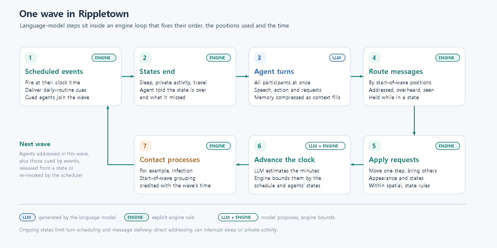

# Rippletown — 연구 방법 (초안, 한국어판)

2026년 10월 13일 · @Whansun

> 이 문서는 영문 초안 [Rippletown — Methods (draft).md](<Rippletown — Methods (draft).md>)의 한국어판이다. 내용이 다르면 영문 초안을 기준으로 한다.

## 프레임워크 개요

Rippletown은 모든 개인을 대규모 언어 모델(LLM) 에이전트가 연기하고, 에이전트가 살아가는 세계는 엔진이 관리하는 다중 에이전트 시뮬레이션 엔진이다. 엔진은 공간, 시간, 이동, 신체 상태, 사회적 관계를 관리하고, LLM은 개인이 무엇을 의도하고 말하며 시도하는지를 생성한다. 엔진은 에이전트의 위치, 동석 여부, 시뮬레이션 시간을 기록하며, 이것이 접촉 분석의 기반이 된다. 장면이 얼마나 걸렸는지처럼 모델이 어떤 양을 제안하는 경우에는 엔진이 그 값을 제한한다.

이 역할 분담은 **엔진 계약(engine contract)**을 통해 에이전트에게 전달된다. 엔진 계약은 시나리오에서 도출한 세계 규칙과 턴마다 달라지는 지시 및 맥락을 결합한다. 이를 통해 답변의 형식, 각 명령의 의미, 에이전트가 말을 걸거나 갈 수 있는 사람과 장소, 현재 시각, 그리고 에이전트의 몸 상태에 대한 서술이 정해진다. 계약은 시나리오와 함께 저장되지 않고 매번 생성되므로, 엔진이 개선되면 기존 시나리오를 수정하지 않아도 그 개선이 반영된다.

각 턴은 하나의 구조화된 답변을 반환한다. 답변에는 에이전트가 누구에게 무엇을 말하는지, 어떤 감정인지, 신체적으로 무엇을 하는지, 그리고 이동, 다른 사람 데려가기, 외모 변경, 수면 같은 상태 진입처럼 세계를 바꾸는 선택적 요청이 담긴다. 엔진은 이 요청들을 공간 및 상태 제약 아래에서 처리하며, 에이전트의 다음 맥락에는 요청한 내용이 아니라 그 결과로 정해진 세계 상태가 반영된다.

엔진은 특정 이야기에 종속되지 않는다. 시나리오가 인물, 페르소나와 관계, 지도, 공유 배경, 예약 이벤트를 제공하므로, 같은 엔진으로 코드 변경 없이 가정, 직장, 학교를 모두 실행할 수 있다. 엔진은 웹 인터페이스 뒤에서 또는 명령줄에서 단독으로 실행되며, 모든 발화, 이동, 상태 변화, 시간 진행을 기록한다. 따라서 실행을 재개하거나 다시 재생하고, 분석용으로 내보낼 수 있다.

## 시간, wave, 하루 일과

시뮬레이션 시간은 **wave**라는 단위로 진행된다. wave는 함께 행동하는 에이전트의 집합이며, 다음 wave에 참여하는 에이전트는 주로 이번 wave에서 말을 건네받은 사람이고, 여기에 예약 이벤트, 상태 종료, 스케줄러가 부른 사람이 더해진다. 따라서 시계의 눈금이 아니라 대화 자체가 다음에 누가 행동할지를 대체로 결정한다. 한 wave 안에서 모든 참여자는 자신에게 전달된 내용을 받아 한 번의 턴을 생성하고, 모든 턴이 함께 처리된 뒤에 세계가 갱신된다.

각 wave가 끝나면 시계는 그 wave가 걸린 시간만큼 진행된다.

```latex
T_{w+1} = T_w + \Delta t_w
```

각 wave의 길이 Δt_w는 언어 모델이 추론한다. 별도의 LLM 호출이 그 wave의 대화와 행동을 현재 시각, 참여자들의 위치, 다음 예약 이벤트와 함께 읽고, 상을 차리거나 방 사이를 오가는 것처럼 화면 밖에서 일어난 행동까지 포함해 장면이 몇 분 걸렸는지 추정한다. 엔진은 이렇게 제안된 값을 일정과 에이전트 상태에 맞게 조정한다.

1. **예약 이벤트.** 아직 발생하지 않은 이벤트를 건너뛰어 시간이 진행되지 않는다.
2. **진행 중인 대화.** 같은 장소의 사람들이 서로 대화하는 동안에는 시간이 크게 건너뛰지 않는다.
3. **낮 시간.** 낮에는 긴 시간 건너뛰기를 제한해 사람들의 오가는 장면이 생략되지 않게 한다.
4. **상태 종료.** 수면 같은 에이전트의 상태가 끝나기로 한 시점을 건너뛰어 시간이 진행되지 않는다.

아무도 누구에게 말을 걸지 않고 아무도 행동하지 않을 때(이동, 상태 변경, 예약 이벤트에 대한 반응이 모두 없을 때), 엔진은 모델에 묻지 않고 점점 큰 간격으로 시간을 건너뛴다. 이때도 예정된 이벤트와 상태 종료가 건너뛰는 폭을 제한한다. 모두가 자고 있거나 다른 일에 묶여 있으면 시계는 다음 이벤트나 상태 종료 시점을 향해 진행된다. 실행은 설정한 시뮬레이션 기간이 지날 때까지 계속된다.

**하루 일과**는 시나리오가 예약 이벤트로 제공한다. 이벤트는 특정 시각에 고정하거나, 선택한 요일에 반복하거나, 시뮬레이션 일차 범위로 제한할 수 있다. 이벤트가 발생하면 학교에 갈 시간이 되었다는 것처럼 해당 에이전트들에게 신호를 전달하고 턴을 준다. 따라서 일정은 시뮬레이션의 입력이고, 그에 대해 각 에이전트가 제시간에 나가는지, 늑장을 부리는지, 먼저 다른 사람과 이야기하는지는 에이전트가 생성한다.

각 에이전트는 매 턴 현재 요일과 시각을 본다. 마지막 턴 이후 충분한 시간이 지났거나 새로운 날이 시작되면 최근 기억에 시각 표시도 기록된다. 이를 통해 에이전트는 기억하는 사건들이 같은 저녁에 일어난 일인지, 서로 다른 날에 일어난 일인지 구분할 수 있다.

## 공간: 장소, 구역, 외부 공간

세계는 이름이 붙은 **장소(place)**들의 그래프이며, 장소들은 **구역(zone)**으로 묶이고, 별도로 지정된 **외부 공간(exterior space)**이 있다. 장소는 동석의 단위다. 에이전트는 같은 장소에 있는 사람과만 대화할 수 있다. 구역은 인지의 단위다. 에이전트는 같은 구역의 다른 곳에 누가 있는지 알지만, 그 사람에게 말을 걸려면 그곳으로 이동해야 한다. 외부 공간은 모델링하지 않은 세계의 일부를 나타내며, 그곳에 있는 에이전트는 아무도 보거나 들을 수 없고 누구도 그에게 말을 걸 수 없다.

이동은 항상 엔진이 처리한다. 에이전트가 목적지를 지정하면 엔진은 구역 경계를 가능한 한 적게 넘는 경로를 찾아 wave마다 한 단계씩 에이전트를 이동시킨다. 구역 안에서의 한 단계 이동은 즉시 이루어진다. 다른 구역으로 넘어가는 것은 물리적인 이동이다. 이동하는 동안 에이전트는 어느 장소에도 있지 않으며, 함께 이동하는 사람 외에는 아무도 만나지 않는다.

중간 구역을 거치는 경로는 **여정(journey)**이 되며, 에이전트는 출발 전에 그 경로를 안내받는다. 도중에 들르는 곳에 만날 수 있는 사람이 있으면 그 만남이 일어날 수 있도록 여정이 멈추고, 에이전트가 같은 목적지를 다시 선택하면 여정이 재개된다. 에이전트의 프롬프트는 목적지를 계속 보여 주므로, 도중에 들렀다고 해서 이동의 목적이 사라지지 않는다.

## 에이전트

각 에이전트는 페르소나, 시작 장소, 외모, 그리고 자신만의 관계 지도로 정의된다. 각 에이전트는 자신만의 기억과 지각 맥락을 가지며, 다른 에이전트의 사적인 기억에는 직접 접근할 수 없다. 시나리오의 공유 배경을 제외하면, 에이전트가 세계에 대해 아는 것은 자신의 지각과 상호작용에서 온다.

### 기억

매 턴 에이전트의 맥락은 정해진 순서로 구성된다. 페르소나, 시나리오의 공유 배경, 장기 기억, 최근의 작업 기억이 차례로 들어가고, 마지막으로 매 턴 새로 생성되며 저장되지 않는 몇 줄(현재 시각, 현재 상황, 몸 상태)이 붙는다.

**작업 기억(working memory)**은 에이전트가 참여한 원문 대화를 담으며, 각 항목에는 그 일이 일어난 시뮬레이션 시점이 표시된다. 작업 기억이 에이전트의 맥락 예산에 가까워지면 **압축(compression)**된다. LLM 호출이 시뮬레이션 일차와 시간대별로 묶인 대화를 에이전트의 기존 기억과 함께 읽고, 세 종류의 장기 기억을 반환한다.

- **에피소드(episode)**: 날짜가 붙은 사건으로, 무엇을 원했는지, 무엇을 했는지, 다른 사람들이 어떻게 반응했는지, 무엇이 바뀌었고 무엇이 아직 해결되지 않았는지를 기록한다.
- **사실(fact)**: 성격, 선호, 습관, 지속적인 관계처럼 시간이 지나도 유지되는 내용이며, 각각 확신도를 가진다. 하루에만 해당하는 세부 사항은 에피소드로 보낸다.
- **관계(relationship)**: 에이전트가 아는 각 사람에 대한 현재의 견해이며, 이전 견해는 이력으로 보관한다.

압축 프롬프트는 "오늘" 같은 상대적 표현 대신 절대적인 일차 표시를 쓰도록 요청한다. 이를 통해 몇 주가 지나도 기억이 모호해지지 않는다.

새로운 사실은 기존 사실 위에 쌓이지 않고 에이전트가 이미 아는 내용과 대조된다. 엔진은 새 대화와 가장 관련 있는 기존 사실을 골라 식별자와 함께 압축 모델에 보여 주고, 압축 모델은 각 새 사실이 새로운 것인지, 기존 사실과 같은지, 기존 사실의 변경인지 판단한다. 엔진은 그 참조를 확인한 뒤 그에 따라 병합한다. 변경된 사실은 이전 버전과 그것을 뒷받침한 대화를 보관하므로, 모든 병합을 추적할 수 있다.

장기 기억은 매 턴 현재 시각을 기준으로 새로 구성된다. 최근 에피소드는 자세히, 오래된 에피소드는 흐릿한 몇 가지 요점으로, 사실은 확신도 순으로 보여 준다. 주기적으로 **정리(consolidation)** 단계가 모든 사실을 검토해, 이후 다시 뒷받침되지 않은 세부 사항의 확신도를 낮춘다. 정리 단계는 아무것도 삭제하지 않는다. 확신도가 낮은 사실은 표시되는 기억에서 빠질 수 있지만, 이후 검색에는 여전히 사용될 수 있다.

### 지각

에이전트는 자신의 위치에서 가능한 것만 지각하며, 그 판단은 wave가 시작될 때 모두가 있던 위치를 기준으로 한다.

**청각.** 발화는 같은 장소에 있는 대상에게 전달된다. 막 자리를 떠난 사람도 작별 인사 정도의 답은 들을 수 있지만, 그 뒤로는 말하는 사람이 따라가야 한다. 일반적인 대화에는 동석이 필요하다. 선택적으로, 같은 장소의 다른 사람들이 누가 누구에게 말했는지 표시된 채로 그 대화를 엿들을 수 있다. 아무에게도 건네지 않은 말은 사적인 것으로 남지만, 그에 따른 신체 행동은 같은 방 사람들이 본다.

**시각.** 에이전트는 사람들이 도착하고 떠나는 것과 그 자리에 있는 사람들의 현재 외모를 보고, 아는 사람의 모습이 달라졌을 때 알아차리며, 자신의 외모도 안다. 같은 구역 안에서는 다른 방에 누가 있는지 알지만 그 사람에게 말을 걸 수는 없다. 계약은 또한 같은 장소에 있는 사람만 볼 수 있다고 에이전트에게 알려, 다른 곳에 있는 사람을 눈앞에 있는 것처럼 묘사하지 않도록 유도한다.

**인식.** 다른 에이전트는 관찰자가 그를 알 때만 이름으로 표시된다(사회 구조 참조). 모르는 사람은 `stranger_1` 같은 임시 표시와 함께 외모로 나타나며, 이름은 상호작용을 통해 알아내야 한다.

### 행동

에이전트는 말하는 것 외에 네 가지 방식으로 세계에 작용할 수 있다.

- **이동.** 에이전트가 장소, 사람 또는 현재 위치를 지정한다. 장소를 지정하면 경로나 여정이 시작된다. 사람을 지정하면 추적이 시작되어, 엔진이 만날 때까지 wave마다 그 사람 쪽으로 에이전트를 이끈다. 현재 위치를 지정하면 그 자리에 머문다.
- **동행.** 목적지와 함께, 같은 장소에 있는 사람들을 데려갈 수 있으며 잠든 사람도 데려갈 수 있다. 동행자는 이끄는 사람과 한 단계씩 함께 이동해 함께 도착한다.
- **외모.** 옷을 갈아입는 것처럼 에이전트가 자신의 외모 서술을 다시 쓰면, 다른 사람들이 그 변화를 보게 된다.
- **상태.** 에이전트가 아래에 설명하는 상태에 들어간다고 선언한다.

### 상태

에이전트는 수면이나 개인 활동 같은 상태에 들어간다고 선언할 수 있다. 에이전트는 상태의 종류만 고르고 길이는 고르지 않으며, 엔진이 그 종류에 정해진 범위에서 지속 시간을 정한다. 엔진은 또한 에이전트가 구역 사이를 이동하는 동안 이동 중 상태로 둔다. 상태에 있는 동안 에이전트는 턴 일정에 포함되지 않으며, 자신에게 직접 건네지지 않은 메시지는 보류된다. 상태가 끝나면 에이전트는 그 사실과 함께 놓친 내용의 요약을 전달받는다. 수면이나 개인 활동은 중단될 수 있다. 같은 장소에 있는 사람이 직접 말을 걸면 에이전트를 깨울 수 있고, 에이전트는 상태를 유지할지 벗어날지 스스로 정한다. 이동 중인 에이전트는 도착할 때까지 닿을 수 없다.

## 에이전트의 역할

Rippletown은 두 종류의 에이전트를 구분한다. **주역 에이전트(protagonist)**는 관찰 대상인 개인이다. 이들은 자율적으로 행동한다. 언제 말할지, 어디로 갈지, 누구를 데려갈지, 언제 잘지를 스스로 정하며, 스케줄러는 이들 중 누구도 오랫동안 턴을 받지 못하는 일이 없도록 한다. **역할형 에이전트(role-bound agent)**는 학교의 교사나 가게의 점원처럼, 주역들이 세계에서 살아가는 데 필요한 서비스를 제공한다. 이들은 연구 대상이 아니며, 그 행동은 의도적으로 제한된다.

| 속성 | 주역 에이전트 | 역할형 에이전트 |
| --- | --- | --- |
| 턴 | 말을 건네받을 때, 예약 이벤트가 있을 때, 스케줄러가 다시 부를 때 | 말을 건네받을 때와 예약 이벤트가 있을 때만 |
| 이동 | 자유로움(다른 사람 데려가기 포함) | 정해진 자리에 고정됨. 이동 요청은 무시되며 프롬프트가 고정된 자리를 알려 줌 |
| 공유 배경 | 시나리오의 공유 배경을 받음 | 자신의 페르소나로만 정의됨 |
| 지각 | 전체 | 주역과 동일하며, 다른 사람들에게 계속 보임 |

이 구분 덕분에 시나리오는 일상을 형성하는 기관들을 포함하면서도, 서비스 인물이 주인공이 되거나 주역들의 턴을 빼앗지 않게 할 수 있다.

## 사회 구조: 관점에 따라 다른 관계

사회적 관계는 각 에이전트 자신의 관점에서 정의된다. 각 에이전트는 다른 에이전트의 식별자를 자신이 그를 부르는 호칭에 연결한 관계 지도를 가진다. 예를 들어 아버지의 관계 지도에는 어머니가 "아내"로, 어머니의 관계 지도에는 아버지가 "남편"으로 적혀 있다. 관계 지도는 대칭일 필요가 없다. A가 B를 적었지만 B가 A를 적지 않았다면, B는 A를 낯선 사람으로 인식한다. 따라서 하나의 구조로 친족 관계, 호칭, 누가 누구를 아는지를 모두 표현한다.

관계 지도는 에이전트가 사회적으로 무엇을 지각하고 할 수 있는지를 정한다. 각 프롬프트는 에이전트가 아는 사람들을 식별자와 관계 호칭과 함께 나열한다(예: `chaemin` ("아내")). 이를 통해 "당신에게는 딸이 있다" 같은 페르소나 문장이 모델이 말을 걸 수 있는 실제 에이전트와 연결된다. 그 자리에 있지만 관계 지도에 없는 사람은 외모 서술과 임시 식별자(`stranger_1`, `stranger_2` 등)로만 나타나며, 이 식별자는 관찰자마다 따로 부여된다. 같은 사람이 어떤 관찰자에게는 낯선 사람이고 다른 관찰자에게는 이름이 있는 가족일 수 있다. 에이전트가 낯선 사람에게 직접 말을 걸면, 그때부터 두 사람은 서로 아는 사이가 된다. 엿들은 대화는 듣는 사람 자신이 아는 범위에 따라 표시된다. 아는 화자는 이름으로, 모르는 화자는 낯선 사람으로, 한 번도 마주친 적 없는 사람은 "누군가"로 표시된다.

관계는 기억 속에서도 변한다. 압축할 때마다 에이전트가 아는 각 사람에 대한 현재 견해가 장기 기억의 관계 부분에 갱신되고, 과거 견해는 이력으로 보관된다. 따라서 한 에이전트가 다른 에이전트를 보는 방식이 실행 동안 어떻게 바뀌었는지 추적할 수 있다.

## wave 처리와 스케줄링

한 wave 안의 처리 순서는 고정되어 있다. 그 순서가 각 에이전트가 무엇을 지각할 수 있었는지를 정하기 때문이다. 예약 이벤트가 먼저 발생하고, 상태가 끝난 에이전트가 풀려난 뒤, 참여하는 모든 에이전트가 동시에 턴을 진행한다. 엔진은 wave가 시작될 때 모두가 어디에 있었는지 기록해 두고, 발화, 엿들은 말, 관찰된 행동을 그 위치를 기준으로 전달한다. 따라서 방을 떠나기 전에 한 말은 그 방에 있던 사람들에게 전달된다. 이동과 외모 변경은 전달이 끝난 뒤 반영되고, 이어서 시계가 진행된다. 감염 모델처럼 누가 함께 있었는지에 따라 달라지는 과정은 마지막에 평가된다. 이 과정은 wave 시작 시점의 동석 구성이 그 wave 내내 유지된다고 가정하고, 그 wave의 경과 시간을 그 구성에 귀속한다.



**그림 1 | Rippletown의 한 wave.** 직전 wave의 메시지, 예약 이벤트, 상태 종료, 스케줄러의 재호출이 참여자를 정하고, 참여자들은 동시에 턴을 진행한다. 메시지는 wave 시작 시점의 위치를 기준으로 전달되고, 구조화된 요청은 공간 및 상태 규칙 아래에서 반영되며, 시계는 모델이 추정하고 엔진이 제한한 간격만큼 진행되고, 감염 같은 접촉 과정은 마지막에 평가된다. 각 단계에는 언어 모델, 엔진, 또는 둘 다 중 무엇이 그 단계를 결정하는지 표시했다.

언어 모델 호출은 에이전트의 턴을 생성하고, 경과 시간을 추정하며, 기억을 관리한다. 메시지 전달, 이동, 상태 변화, 접촉 평가는 명시적인 엔진 규칙을 따른다.

두 가지 스케줄링 안전장치가 언어 모델이 행동할 사람을 정하지 않고도 시뮬레이션이 계속 진행되게 한다.

- **재호출.** 한동안 턴을 받지 못했고 상태에 있지 않은 주역 에이전트에게는 들어온 메시지 없이 턴을 준다. 따라서 혼자 다른 방에 간 에이전트도 하루를 계속 이어 간다.
- **집단 침묵.** 아무도 누구에게 말을 걸지 않고 아무도 행동하지 않으면, 참여 가능한 모든 주역 에이전트를 한 번 부른다. 침묵이 계속되면 소외된 사람만 부르고, idle 점프로 시간을 진행한다(시간 절 참조).

## 기록과 재분석

모든 실행은 설정, 이벤트, 에이전트별 스냅샷을 기록한다. 스냅샷에는 위치, 경로, 상태, 보류된 메시지, 아는 사람, 마지막으로 본 외모가 포함되므로, 실행을 기록된 상태에서 재개하거나 설정을 바꾸어 이어서 진행할 수 있다. 각 wave 시작 시점에 모두가 어디에 있었는지에 대한 기록도 내보내므로, 다른 전파 파라미터를 적용한 감염 모델 같은 접촉 기반 분석을 언어 모델을 다시 실행하지 않고 재계산할 수 있다. 이러한 재계산은 생성된 행동을 고정한다. 즉 증상이 나타난 뒤 서로 떨어져 지내는 것처럼 새로운 감염 결과에 대한 에이전트의 반응은 다시 생성되지 않는다. 엔진은 자동화된 회귀 테스트 묶음으로 검증된다.
